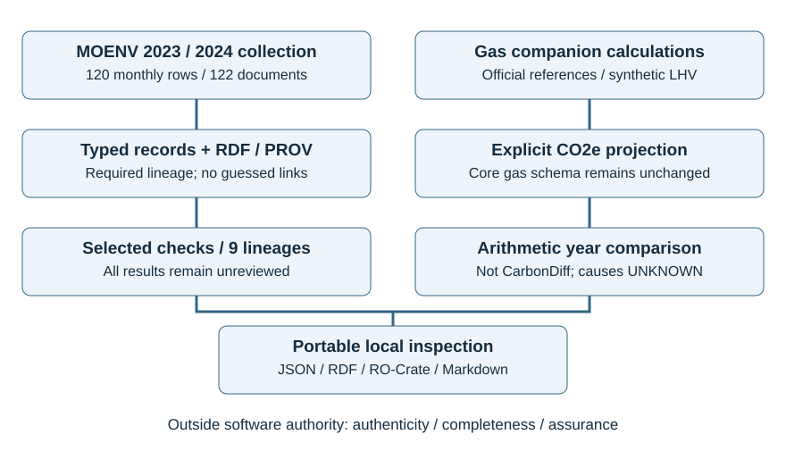
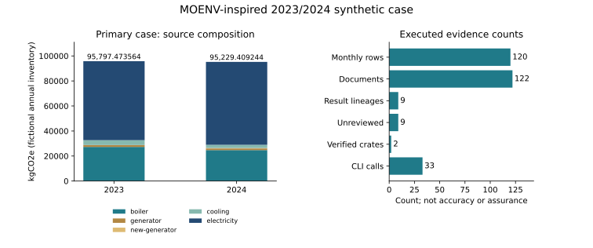

# GHG Assurance Graph: Inspectable provenance and bounded comparison of organizational emissions

**Reconciled content draft — 16 October 2026. Qualified alpha 0.4.0a1. Not submitted or human-approved.**

Authors, affiliations, postal addresses and corresponding-author email: **pending owner confirmation**. No authorship or institutional endorsement is inferred from repository ownership.

## Abstract

GHG Assurance Graph is an offline Python toolkit for inspecting organizational greenhouse-gas evidence without turning absent internal records into invented assurance. Its primary example is a fully fictional single-site manufacturing case for 2023 and 2024, with original collection forms mapped to Taiwan Ministry of Environment (MOENV) guidance. The case contains 120 monthly activity rows, 122 synthetic documents, gas-level companion calculations and nine canonical result lineages. An executed 33-command workflow checks collections and graphs, preserves all nine unreviewed statuses, verifies two portable packages and exports graph-derived notes. Annual totals are 95,797.473564 and 95,229.409244 kgCO2e; the arithmetic difference is not an independently established reduction. Selected negative controls reject missing months, package tampering and an unsupported comparison route. Older synthetic benchmark results remain separate software regressions, not measurements of this case. Validation is synthetic-only. Neither document hashes, graph consistency nor successful replay establishes source truth, completeness, legal conformity or an assurance opinion.

**Keywords:** greenhouse gases; provenance; SHACL; reproducibility; change attribution; evidence graphs

## Software metadata

| Nr | Code metadata description | Metadata |
|---|---|---|
| C1 | Current code version | 0.4.0a1, qualified alpha |
| C2 | Permanent link to code/repository used for this code version | Pending immutable release link; working repository https://github.com/simon5530/ghg-assurance-graph |
| C3 | Legal code license | MIT; upstream dependencies retain their licenses |
| C4 | Code versioning system used | Git |
| C5 | Software code languages, tools and services used | Python; local CLI/library; no hosted service required |
| C6 | Compilation requirements, operating environments and dependencies | Python 3.12; local Python 3.12.14 on macOS arm64; MOENV dataset workflow hosted checks passed at source 747c78c; expanded guide runner CI recorded separately; uv.lock; Pydantic, Pint, RDFLib, pySHACL 0.31.0, RO-Crate 0.15.1; package verification requires POSIX facilities |
| C7 | If available, link to developer documentation/manual | https://github.com/simon5530/ghg-assurance-graph/tree/main/docs (mutable; release permalink pending) |
| C8 | Support email for questions | Owner must provide an approved email; interim support through repository issues |

## 1. Motivation and significance

Organizational greenhouse-gas inventories combine activity evidence, emission factors, characterization conventions, boundaries and review decisions. A plausible total does not identify these dependencies. A year-to-year decrease may reflect changed activity, a corrected input, a different factor or a reporting-boundary change. Researchers need to inspect those alternatives before interpreting a numerical trend. The GHG Protocol Corporate Standard, Scope 2 Guidance and Scope 3 Standard define distinct accounting contexts [1–3]; a software check cannot substitute for establishing their applicability.

GHG Assurance Graph addresses a narrower problem: preserving inspectable evidence relationships, executing selected consistency checks and displaying what a comparison cannot explain. A researcher supplies local structured records, runs a command-line workflow, examines findings and exports a portable evidence directory. Two input profiles prevent an important category error. Calculated results require declared calculation lineage; optional reported totals remain attributed assertions when that lineage is unavailable. Neither profile supplies an independent assurance opinion.

Existing infrastructure is reused rather than reimplemented. PROV-O represents provenance, SHACL supplies graph constraints, and RO-Crate describes portable research objects [4–6]. TEC Toolkit already combines carbon ontologies, PROV-based calculation provenance and executable validation [7]. CarbonLedger implements factor-vintage restatement [8]. Consequently, neither carbon provenance nor numerical factor-change attribution is claimed as new. The contribution is an experimental organizational-GHG integration with explicit authority boundaries, conservative missing-evidence behavior and reproducible examples. No comparative superiority has been measured; the repository's scoped GO rests on a same-case primary-source comparison of the remaining organizational integration contract, not universal novelty or practitioner endorsement.

## 2. Software description

### 2.1. Architecture and implementation

The implementation separates ingestion, canonical records, graph construction, validation, comparison and export (Figure 1). Pydantic rejects unknown fields and invalid references; Pint checks supported physical dimensions. RDFLib constructs collision-checked graphs and executes five allowlisted query templates. pySHACL runs packaged Core shapes with imports, advanced rules, JavaScript and inference disabled. Calculation and comparison do not require a language model, cloud credential, database or web service. Evidence URLs remain inert citations rather than instructions or automatically fetched inputs.

**Figure 1.** Primary MOENV training workflow: monthly collection and evidence, gas-level companion arithmetic, canonical CO2e projection, selected graph checks and portable outputs. Optional reported assertions and legacy CarbonDiff are separate compatibility/regression branches, not evaluation of the primary case. Human source interpretation and assurance remain outside the computational boundary. Original schematic generated by the accompanying deterministic Python script; AI assisted its code and explanatory design. No source-report or standards artwork is reproduced.

The canonical schema has 17 record types covering organizations, facilities, periods, inventory versions, sources, activities, evidence, factors, GWP sets, methods, runs, results, boundaries, quality, reviews, changes and findings. Logical identifiers are distinct from revision identifiers. Conflicting content under one revision is rejected; no fuzzy identity matching silently joins inventories. Results link to generating calculations, calculations to used inputs, and reviews to reviewed targets. A retrospective review is not represented as generating the emissions result.

Calculated packages require explicit factor, method, GWP and boundary context. The bounded profile supports one activity and factor per run, not arbitrary multi-input life-cycle models. Generic JSON/CSV interchange accepts caller-mapped external results with complete provenance; it is not a tested PACT, openLCA or Brightway integration. Graph-derived Markdown provides an optional Obsidian inspection view without making Obsidian the database.

### 2.2. Validation and optional reported assertions

Validation combines closed schemas, reference integrity, selected SHACL constraints and independent raw-row domain rules. Findings have stable identifiers and explicit rule/target/severity fields. Checks include factor provenance, supported units, review metadata and arithmetic consistency. Raw decimal strings are checked using exact rational arithmetic, independently of the benchmark calculator. The primary collection profile checks monthly completeness, document balances, identifiers, units, hashes, equipment cutoffs and gas-level results separately from canonical graph validation. The generator projects gas calculations to precharacterized CO2e; the core schema itself remains gas-unresolved. Historical electricity vintages and synthetic LHV are declared teaching policies, not a legal applicability decision.

An optional generic reported-disclosure/1 profile, outside the empirical evaluation here, stores organization, year, scope/category, Scope 2 basis, decimal-string quantity, source URL/hash/page/retrieval time and explicit boundary, GWP, restatement and rounding metadata. Unknown metadata remains null. A ReportedAssertion does not become an EmissionResult, ActivityRecord or CalculationRun. Validation distinguishes assessed, invalid and not_assessable; the last is neither a defect nor a pass. Report-wide status remains not_assessable because totals alone cannot establish source authenticity, upstream recalculation or independent assurance.

Scope 2 location-based and market-based values are alternatives, never additive. Totals and their components are also not blindly summed. Reported-profile comparisons match explicit series and report arithmetic deltas separately from comparability. Missing years are missing, not zero. Where a total reconciliation is eligible, the tolerance uses disclosed rounding increments; an absent increment is not replaced with an invented tolerance.

### 2.3. CarbonDiff

As a separate legacy regression capability, CarbonDiff compares validated ExampleCo-GHG-001 raw snapshots through asserted namespace and stable row identifiers. For activity q, unallocated factor f and allocation share s, its ordered decomposition is:

- Activity component: (q1 − q0) × f0 × s0.
- Factor component: q1 × (f1 − f0) × s0.
- Allocation component: q1 × f1 × (s1 − s0).

Interaction terms therefore belong to later operands. This is an explicit accounting convention, not uniquely identified causation. Bounded Decimal arithmetic isolates precision from the caller's context and enforces exact reconciliation: attributed change plus signed UNKNOWN residual equals the difference in totals. Absolute UNKNOWN exposure is reported separately so opposing unexplained changes cannot disappear through cancellation.

Unsupported substantive changes make the row's delta UNKNOWN unless a caller supplies a scoped semantic declaration covering the observed changes. Declarations contain evidence text and a label, not an expected amount. They are assertions requiring review, not authenticated causal evidence. Changed method, GWP or allocation policy must not silently become operational improvement. Those regression-profile restrictions do not erase the primary case's explicit companion gas arithmetic. The MOENV folders do not satisfy the legacy raw-snapshot contract: ghgag diff rejects them. The primary workflow instead reports a labelled arithmetic comparison with causal explanations UNKNOWN; it does not claim CarbonDiff migration or semantic attribution for these years.

### 2.4. Portable evidence and reproducibility

The RO-Crate-based export contains canonical JSON, Turtle, JSON-LD, schema, vocabulary descriptor, metadata and a closed manifest. Explicit timestamps, software versions and commands support replay. Verification checks file membership, hashes, canonical payloads and regenerated exports without dereferencing remote contexts. Unexpected files, symlinks and inconsistent payloads are rejected. This verifies a bounded application profile, not every possible RO-Crate. A separately retained manifest digest can anchor integrity, but hashes alone do not authenticate an invoice, factor or assurance statement.

## 3. Illustrative examples

### 3.1. Primary MOENV-inspired two-year internal evidence case

The primary case is a completely fictional manufacturing site for calendar years 2023 and 2024. Original internal collection forms map to the inspected MOENV inventory workbook tables 1–11 and all-industry report chapters [10]. Evidence indexing and change tracking are two project extensions, not alleged official requirements. Public-company benchmarking is excluded: a public annual total does not provide internal meter readings, custody records or calibration evidence, and the software must not invent those for a named company.

The five declared source positions cover a natural-gas hot-water boiler, an existing stationary diesel backup generator, a second generator installed on 1 July 2024, HFC-134a cooling equipment and purchased electricity. Each year contains 60 monthly rows and 61 synthetic documents, including the annual scenario declaration. The uninstalled generator has documented inactive records in 2023, but no fabricated emissions result. Monthly electricity/gas meter differences, fuel opening-stock plus purchases minus closing-stock, and refrigerant mass balances reconcile to activity quantities. A missing observation is not zero. The scenario excludes process gases, onsite wastewater treatment, biomass and purchased steam by explicit fictional equipment/process assumptions, not general industry exemption rules. It is not a complete corporate Scope 3 inventory.

MOENV's facility/registered boundary must not be substituted by a corporate consolidation policy. This site's registration is a clearly non-real placeholder; operational-control graph metadata does not prove a statutory boundary. The source ledger fixes downloaded bytes, versions and dates: 113-year guidance and report template, June-2026 collection workbook, code workbook V2 and announced coefficients. These materials have different publication/update dates. Official source files and copyrighted standards are not redistributed.

### 3.2. Quantification, parameters and the traceable calculation

Combustion uses transcribed official stationary-fuel coefficients in kg gas/TJ. Synthetic lower heating values of 38 MJ/m³ for natural gas and 36 MJ/L for diesel convert activity to energy; they are assumptions, not laboratory measurements. CO2, CH4 and N2O masses are characterized once using the inspected AR5-based GWP values 1, 28 and 265. HFC-134a uses 1300, not an unlabelled value from another assessment. Refrigerant purchases or equipment charge are not automatically emissions: the synthetic service balance supplies leaked mass.

For example, 2023 boiler consumption sums to 12,780 m³. CO2e is 12,780 × 38 / 1,000,000 × (56,100 + 1 × 28 + 0.1 × 265) = 27,270.87138 kgCO2e. The companion table retains each gas calculation and units. Independent Fraction arithmetic checks the Decimal result against literal expectations. The canonical graph receives a declared composite kgCO2e/unit factor; GWP is not applied again. This projection is explicit, not a claim that schema 0.1 gained a complete gas-resolved inventory model.

Historical electricity factors 0.494 and 0.474 kgCO2e/kWh replay values in the inspected official example workbook. The announced rule refers to the latest applicable factor at inventory/verification time; this demonstration deliberately freezes historical vintages for teaching. It is therefore not a finding of statutory factor applicability for either historical or current filings. Real users must establish the reporting purpose, applicable version and restatement policy before using actual factors.

**Table 1.** Primary fictional source results, kgCO2e, independently checked from monthly records. The 2023 new-generator zero reflects declared non-installation, not missing-data imputation.

| Source | 2023 | 2024 |
|---|---:|---:|
| Natural-gas boiler | 27270.87138 | 24710.22618 |
| Existing diesel generator | 1493.402184 | 1332.821304 |
| New diesel generator | 0 | 321.16176 |
| HFC-134a leakage | 3900 | 2600 |
| Purchased electricity | 63133.2 | 66265.2 |
| Total | 95797.473564 | 95229.409244 |

### 3.3. Executed user workflow and observed outputs

After a locked installation, one command runs the primary demonstration:

~~~sh
uv sync --locked
uv run python scripts/run_moenv_example.py --out artifacts/moenv-worked
~~~

The destination must be new. Open REPORT.md, then commands.json and summary.json. The runner invokes real CLI parsers in-process with captured stdout, stderr and exit codes; a process-local socket guard blocks networking after installation, not an OS sandbox. It reuses the installed collection profile and graph/export implementations, not a second tutorial calculator. An optional --python switch tests a separately installed interpreter without injecting checkout source paths.

The recorded workflow has 33 CLI invocations, 30 successful and three intentionally rejected requests. Both 60-row collections validate. The canonical packages have 50 and 61 records, with four and five result lineages respectively. All nine query explanations resolve their declared activity, evidence, factor, method, GWP, boundary, inventory and review. All nine review statuses remain unreviewed; graph consistency does not manufacture acceptance. Both selected canonical validations return no findings. Negative controls reject a missing month, an extra file in a crate and direct use of legacy CarbonDiff on the MOENV folders, each exiting 2 at its actual failing boundary.

Purchased electricity illustrates inspection: the 2023 explanation reports 63,133.2 kgCO2e, 127,800 kWh × 0.494, plus the declared evidence and factor references. Querying unreviewed_results returns four rows for 2023 and five for 2024. These are stored relationships and states, not authenticated meter observations or practitioner assessments.

**Figure 2.** Values read from the executed MOENV summary: annual source totals and selected workflow counts. Both years remain fictional; all results are unreviewed. No seeded-defect accuracy, population-level performance or measured emissions reduction is inferred. Original deterministic computational figure with AI-assisted code; no generative-image or third-party artwork.

The arithmetic comparison sums per-source changes to −568.064320 kgCO2e. The added generator's zero predecessor is supported only by its explicit non-installation declaration. All causal explanations remain UNKNOWN. Neither altered activity, factor vintage, refrigerant balance nor the numerical decrease is automatically labelled abatement. The legacy CarbonDiff result cannot be presented as a test of these folders.

Two closed-profile canonical RO-Crates verify, while separate Markdown exports contain 127 and 140 notes with internally resolved links. The closed crates contain graph/canonical records and evidence citations, not the full monthly document tree. Users must preserve the entire run output and manifest, including generated/YEAR/evidence, to retain that chain. Hash consistency is not document authentication. Desktop Obsidian behavior is untested.

### 3.4. Verification scope and separate regression evidence

Primary-case tests use literal annual/source values and an independent Fraction oracle. They exercise missing/duplicate rows, blank and nonfinite quantities, wrong units/periods, evidence corruption, equipment cutoffs, altered saved results and overwrite refusal. The documented runner additionally executes graph queries, exports, package verification and failure paths. Filled workbook formulas were mutation-tested; removing a required month exposes MISSING. Workbook edits do not update external CSV, source files or hashes automatically, and native Excel execution was not verified.

The older ExampleCo-GHG-001 benchmark is retained only as a separate software regression population. Its 45 lineages, ten authored defects and nine declaration-assisted components do not become MOENV observations. Its public, nonblind labels informed development; no resulting score estimates performance on unseen inventories. The generic reported-assertion profile is likewise compatibility functionality, not listed-company evaluation.

The October 15 dataset checkpoint passed hosted tests, build and installed-wheel replay for the then-documented regression workflow. That does not prove the expanded primary runner or reading artifacts until their own checks complete. Source revisions and hosted receipts are recorded in the results ledger. No real-company transfer, independent practitioner validation, actual instrument calibration, quantified uncertainty, deployment adoption or assurance opinion is claimed.

## 4. Impact

The immediate utility is methodological transparency: a researcher can ask which factor revision supports a result, which evidence is missing, and whether a numerical change has sufficient context for interpretation. A second use is teaching the distinction between internally consistent data and a substantiated inventory. The optional reported profile is designed to preserve “not assessable” rather than invent missing lineage; that design is not externally validated here.

The software enables future studies of review effort, error discovery and disagreement over attribution conventions. It also supplies a reproducible starting point for comparing an evidence overlay with existing accounting and semantic-provenance tools. Those are prospective uses, not established outcomes. There are no measured independent users, adoption counts, commercial deployments, reductions in review time or publications using this software. Download statistics and repository activity are not substituted for research impact.

Important limitations remain. Companion gas calculations do not make the core model a complete gas-resolved inventory system; it does not implement category-level uncertainty, organizational controls, full significance screening, production recalculation or independently authenticated review. ISO 14064-1:2018 source inspection informs a documented coverage assessment [9]; it does not establish conformity, and ISO categories must not be conflated with GHG Protocol scopes. Scope 2 contractual eligibility is not proved by retaining a market-based number. Synthetic policy restrictions do not become normative requirements. Broader matching, simultaneous semantic causes and vendor-specific adapters require further implementation and validation.

The authority boundary is deliberate: software may expose relationships and reconcile declared quantities, while qualified people must decide source truth, completeness, methodological appropriateness and assurance. Future evaluation should include independently specified cases, practitioner review and external reproduction before stronger claims are made.

## 5. Conclusions

GHG Assurance Graph provides an inspectable, offline evidence workflow connecting typed organizational-GHG records, semantic provenance, selected validation, bounded change comparison and portable outputs. Synthetic-only results demonstrate encoded contracts and unresolved changes; no external validation is claimed. The qualified alpha is a reproducible research artifact, not a certified accounting system or autonomous assurance provider. Human review and stronger impact evidence remain publication-development needs; local replay does not provide those forms of validation.

## Code and data availability

MIT source and synthetic fixtures are available at https://github.com/simon5530/ghg-assurance-graph. This draft describes the 0.4.0a1 working-tree qualified alpha; an immutable release commit, current-release archival identifier and DOI remain pending. Primary inputs are examples/moenv_training/sample, profile moenv-training/1. Executed reference receipts are in examples/moenv_training/workflow. The distinct benchmark/generated and benchmark/ground_truth 0.1 (seed 20250926) are legacy regression inputs only. No company reports, licensed standards text or private evidence are needed for the experiment. Editable figures and the manuscript renderer are included; the PDF is a reading copy, not the official submission format. Historical v0.3 release/archive identifiers do not identify the current code.

## CRediT authorship contribution statement

Pending named authors' approval. Conceptualization, methodology, software, investigation, data curation, validation, visualization and writing roles must be assigned to actual eligible contributors; no assignment or author consent is asserted here. AI systems are not authors.

## Funding

Funding and sponsor involvement require owner confirmation. Neither funding receipt nor absence of funding is asserted.

## Declaration of competing interest

Pending disclosure by every named author. A “no competing interests” declaration has not been authorized.

## Declaration of generative AI and AI-assisted technologies

OpenClaw using openai/gpt-6-astra assisted the earlier software and draft. OpenClaw using openai/gpt-6.1-sol assisted the MOENV case, workflow reconciliation, tests, documentation and this revised draft and deterministic figure code. Earlier standards PDF inspection also used google/gemini-pro-latest, as recorded in the repository AI usage log. No model is required to reproduce the software results. Automated checks do not replace independent human verification. Human authors must review, revise and accept responsibility before submission; that approval has not yet occurred.

## Acknowledgements

No named acknowledgements are included pending permission and owner confirmation.

## References

[1] World Resources Institute and World Business Council for Sustainable Development. The Greenhouse Gas Protocol: A Corporate Accounting and Reporting Standard. Revised edition; 2004. https://ghgprotocol.org/corporate-standard (accessed 26 September 2026).

[2] World Resources Institute. GHG Protocol Scope 2 Guidance. 2015. https://ghgprotocol.org/scope-2-guidance (accessed 26 September 2026).

[3] World Resources Institute and World Business Council for Sustainable Development. Corporate Value Chain (Scope 3) Accounting and Reporting Standard. 2011. https://ghgprotocol.org/corporate-value-chain-scope-3-standard (source PDF inspected 26 September 2026; see source ledger).

[4] W3C. PROV-O: The PROV Ontology. W3C Recommendation, 30 April 2013. https://www.w3.org/TR/prov-o/ (accessed 28 September 2026).

[5] W3C. Shapes Constraint Language (SHACL). W3C Recommendation, 20 July 2017. https://www.w3.org/TR/shacl/ (accessed 28 September 2026).

[6] Research Object community. RO-Crate Metadata Specification, version 1.2. Published 4 June 2025. https://www.researchobject.org/ro-crate/specification/1.2/ (accessed 28 September 2026).

[7] TEC Toolkit. Transparent Emissions Calculation Toolkit; PECO and Data-Validation repositories. https://tec-toolkit.github.io/ (accessed 24 September 2026; inspected repository commits recorded in docs/RELATED_WORK.md).

[8] CarbonLedger project. Carbon-Ledger software, commit ce9f16ed1d987753555d366ceae94e23c81c32b7. https://github.com/jackson-marcus/Carbon-Ledger/tree/ce9f16ed1d987753555d366ceae94e23c81c32b7 (accessed 24 September 2026).

[9] International Organization for Standardization. ISO 14064-1:2018: Greenhouse gases — Part 1: Specification with guidance at the organization level for quantification and reporting of greenhouse gas emissions and removals. Second edition; 2018. https://www.iso.org/standard/66453.html (metadata and bounded licensed-source review recorded 28 September 2026).

[10] Taiwan Ministry of Environment. GHG inventory guideline (113-year edition), all-industry inventory report reference template, inventory workbook example (June 2026 update), code workbook V2 and announced emission factors (5 February 2024). https://ghgregistry.moenv.gov.tw/epa_ghg/Downloads/FileDownloads.aspx?Type_ID=1 (files inspected and SHA256-recorded 15 October 2026; individual URLs, versions and restrictions in examples/moenv_training/official-sources.json and SOURCES.md).
